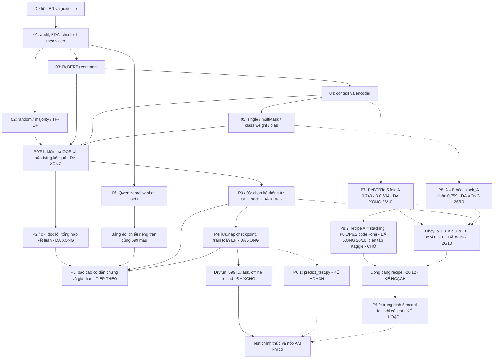

# Roadmap và pipeline — CS221 / StereoQueerEval
**Một tài liệu kế hoạch duy nhất — cập nhật 20/10/2026 sau khi kiểm chứng P4 smoke/dryrun/final từ Kaggle; 26/10/2026 thêm kế hoạch nâng cấp P6–P10 và kết quả P7/P8 ([mục 6.1](#nang-cap)).**
Phạm vi: **Subtask A + B, English**.
[Handoff](../HANDOFF_CS221.md) là bản bàn giao trạng thái; [worklog](../WORKLOG_CS221.md) là lịch sử công việc.
Nội dung PIPELINE.md đã được gộp vào file này.

## 1. Bạn đang ở đâu, nhanh hay chậm?
**Vị trí hiện tại: P0–P4 đã hoàn thành; đã có checkpoint final train toàn bộ 2.989 mẫu. Bước tiếp theo là P5: báo cáo và bàn giao.**
Đã kiểm chứng ba ZIP Kaggle tại máy ngày 20/10; chưa có kết quả test hoặc lần nộp chính thức của BTC trong các output này.

| Phần công việc | Trạng thái hiện tại |
|---|---|
| Hiểu dữ liệu và thiết lập đánh giá | Xong: EDA, 2.989 mẫu EN, 243 nhóm video, 5 fold |
| Baseline và model chính | Đã chạy TF-IDF, RoBERTa; có OOF hợp lệ |
| Context, multi-task, Qwen | Đã chạy; Qwen 4×599 dự đoán đã kiểm chứng; DeBERTa được ghi nhận là failed |
| Kiểm tra và sửa dữ liệu kết quả — P0/P1 | **Xong:** phục hồi bảng 05, chặn OOF hỏng, sửa NaN ensemble, 35 test đạt |
| Đọc lỗi và viết kết luận — P2 | **Xong:** user đọc 30/30; đã kiểm tra nguồn, tổng hợp 8 ví dụ, đối chiếu 7 mẫu Qwen và viết kết luận riêng |
| Chọn lại hệ thống cuối — P3 | **Xong 18/10; chạy lại 26/10 có DeBERTa:** A **giữ** greedy+bias 0,7460 (bản mới chỉ +0,0011, 2/5); B **đổi** sang top-3+bias có DeBERTa **0,6159** (+0,0084, 5/5). Recipe trộn A cũ + B mới đã ghi vào `recipe.json` |
| Lưu/nạp model và đóng gói suy luận — P4 | **Xong:** smoke/dryrun/final trên T4; 7 checkpoint/lượt, offline reload đạt; dryrun 599 ID/task, final train 2.989 mẫu |
| Báo cáo môn và nộp cuộc thi — P5 | Chưa xong; lịch/hạn môn cần xác nhận |
| Nâng cấp cho vòng test BTC — P6–P10 | **27/10:** ✅ P7 · ✅ P3 lại · ✅ P8 · ✅ P8.2a (A = stacking) · ✅ P6.1/P6.2 · ✅ **P8.2b diễn tập 1 trên Kaggle: quy trình chạy trọn (164 phút), A 0,7458 / B 0,6365 trên fold 0** · ⚠️ phát hiện lệch phân phối stacker/bias → đã sửa (áp theo fold) · ⏳ **diễn tập 2 (v2) – chờ user chạy** rồi quyết định A/B theo quy tắc đặt trước ([mục 6.1](#nang-cap)) |

**Đánh giá tốc độ:** so với lịch gốc, phần chạy thí nghiệm đang đi trước.
Lịch gốc dành 12–25/10 cho bước 2–3, 26/10–08/11 cho context và 09–22/11 cho multi-task/LLM;
artifact hiện có cho thấy các lượt này đã chạy trong 11–14/10 và được rà soát/sửa kết quả ngày 18/10.
Đến 20/10, cả ba lượt P4 đã tải về và kiểm chứng, gồm bộ checkpoint toàn dữ liệu.
Đây là so sánh mốc công việc, không có nghĩa đã hoàn thành báo cáo hoặc hệ thống nộp bài.

**Chưa thể kết luận dư hay thiếu thời gian theo hạn môn**, vì ngày nộp chưa được xác nhận.
Không dùng “8/8 notebook” làm phần trăm hoàn thành đồ án.
Điểm cần tập trung lúc này là đưa kết luận P2/P3 và bằng chứng P4 vào báo cáo, chuẩn bị bàn giao;
chưa cần thêm model hay chạy lại toàn bộ 01–08.

**Cách đọc số thứ tự:** notebook 01–08 là các file thí nghiệm. P0–P5 là các mốc hoàn thiện
sau khi đã có kết quả; **P2 không có nghĩa quay lại notebook 02**.

## 2. Bài toán và sản phẩm cần bàn giao
Input là comment YouTube, có thể kèm tiêu đề và mô tả video.
- **A:** có stereotype về LGBTQIA+ không → `no / yes`.
- **B:** có hate speech không, thể hiện thế nào → `no / yes_implicit / yes_explicit`.
- Metric chính: macro-F1, kèm F1/recall từng lớp; không chọn model chỉ vì ô `no/no` lớn.
- Train EN hiện có: 2.989 mẫu / 243 nhóm video; dùng nguyên `data/splits/folds_en.csv`.
- Scope hiện tại không mở rộng sang C/IT/NL/Persian. 100 mẫu Persian development là nhánh riêng,
  không nhập vào EN folds hay tính chung với metric EN.

Sản phẩm: thí nghiệm có thể kiểm chứng, bảng kết quả đúng phạm vi đánh giá, phân tích lỗi,
recipe có lý do lựa chọn, model/tokenizer/config có thể nạp lại, TSV dự đoán hợp lệ và báo cáo.
Hạn nộp môn **chưa xác nhận**. Lịch BTC ghi ở phần cuối là thông tin cũ, cần kiểm tra trước lúc nộp.

## 3. Pipeline từ dữ liệu đến hệ thống

Đường nét đứt là kế hoạch nâng cấp P6–P10 (chi tiết ở [mục 6.1](#nang-cap)), chưa thực hiện.
Qwen hiện chỉ có nhãn trên fold 0; không đưa vào ensemble xác suất của notebook 08.
Few-shot lấy ví dụ từ fold 1–4, không trùng ID/video của tập đang chấm.

## 4. Bản đồ 8 notebook
| Notebook | Câu hỏi cần trả lời | Đầu ra / trạng thái |
|---|---|---|
| 01 — EDA | Dữ liệu có gì, nhãn nào khó, cần chia thế nào? | Dữ liệu/folds đã kiểm tra; đọc guideline và ví dụ trước khi giải thích lỗi |
| 02 — classical | Cách đơn giản làm được tới đâu? | Random/majority/TF-IDF, OOF và mốc so sánh |
| 03 — transformer | Fine-tune RoBERTa có hơn TF-IDF không? | Có OOF hợp lệ A/B; checkpoint cho các thành phần được chọn đã lưu riêng ở P4 |
| 04 — context | Title/description giúp hay gây nhiễu? | RoBERTa/Twitter-RoBERTa hợp lệ; DeBERTa failed, không dùng điểm giả majority |
| 05 — multi-task | Học A/B chung, class weight và bias có ích không? | **Bảng 12 dòng đã phục hồi** từ OOF; code logger đã sửa |
| 06 — LLM | Không fine-tune, Qwen zero/few-shot làm được tới đâu? | Full 4×599, 0 failed attempts; đã kiểm chứng và merge |
| 07 — error analysis | Model sai ở đâu và vì sao? | 30/30 ghi chú P2 được giữ; 12 code cell đã chạy với OOF P3, có kết luận và output riêng |
| 08 — ensemble/submission | Chọn hệ thống nào và xuất dự đoán thế nào? | P3 đã chọn bằng script CPU; notebook 9 code cell đã chạy, train/test P4 mặc định tắt |

Cả 8 notebook từng chạy đầy đủ trước P1. Sau sửa P1/P3, **07 và 08 đã được chạy lại trên CPU**;
05 chưa train/chạy lại toàn notebook, bảng 12 biến thể được phục hồi từ OOF. Notebook 06 và dự đoán gốc giữ nguyên.
Bản trước P1/P3 nằm trong `outputs/audit/2026-10-18-p1/before/` và `outputs/audit/2026-10-18-p3/before/`.
Dry-run cũ không đại diện cho recipe P3 mới. Runner P4 riêng đã train/save/reload recipe mới; ba gói smoke/dryrun/final được kiểm chứng ngày 20/10.

## 5. Kết quả và hướng nghiên cứu hiện tại
### Supervised — mean ± std 5 fold theo video
| Cấu hình | A | B |
|---|---:|---:|
| TF-IDF comment | 0,7002 ± 0,0209 | 0,5249 ± 0,0138 |
| RoBERTa comment | 0,7274 ± 0,0098 | 0,5856 ± 0,0179 |
| Twitter-RoBERTa-hate comment | 0,7335 ± 0,0115 | 0,5870 ± 0,0114 |
| Multi-task cùng encoder, không cw/bias | 0,7354 ± 0,0111 | 0,6006 ± 0,0259 |
| **DeBERTa-v3-base comment (P7, 26/10)** | **0,7404 ± 0,0090** | **0,6041 ± 0,0192** |

Các số này là điểm phát triển/CV, không phải test độc lập của BTC.
Bảng các biến thể 05: [nb05_restored.csv](outputs/results/nb05_restored.csv).

Context chưa cải thiện ổn định: A thêm title+description +0,0014 nhưng thắng 3/5 fold;
B thêm title −0,0048, title+description −0,0164, ghép thẳng −0,0350 so với comment-only.
Không kết luận ngữ cảnh luôn vô ích; chỉ mô tả kết quả của các cách đưa ngữ cảnh đã thử.

### LLM — cùng fold 0, 599 mẫu, không có std 5 fold
| Hệ thống | A | B |
|---|---:|---:|
| Qwen zero-shot | 0,6074 | 0,4612 |
| Qwen few-shot | 0,6927 | 0,5187 |
| TF-IDF comment | 0,7056 | 0,5245 |
| RoBERTa comment | 0,7314 | 0,6171 |

Qwen Q4_K_M dùng title+description+comment; baseline trong bảng dùng comment.
Few-shot cải thiện F1 implicit B 0,1611 → 0,3402 nhưng F1 explicit giảm 0,5362 → 0,5132.
Giữ Qwen như thí nghiệm đối chiếu; **supervised ensemble đã chọn ở P3 là hướng chính hiện tại**.

### Sau P3 — trạng thái hiện hành
- **A:** greedy + bias, 0,746020 ± 0,010278; **B:** top-3 mean + bias, 0,607455 ± 0,012700.
- So 6 chiến lược/task trên 9 ứng viên hợp lệ, 60 điểm theo fold. Chọn theo quy tắc gain ≥0,005 so với single tốt nhất có/không bias.
- B: F1 implicit 0,4313 → 0,4631; no giảm, explicit gần như giữ nguyên. Không phải mọi lớp đều cải thiện.
- Thành phần/trọng số/bias đều fit ngoài fold đang chấm. Điểm vẫn là development OOF cross-fit, chưa phải nested CV độc lập toàn pipeline hoặc test của recipe toàn OOF.
- Master **40 dòng**: 36 completed_valid, 2 failed_nonfinite, 2 superseded_p3. `load_results()` mặc định trả 36 valid.
- Giữ nguyên 32 OOF gốc (30 hợp lệ, 2 DeBERTa NaN); OOF của chiến lược P3 ở `outputs/selection/`.
- **38 test đạt**, 07/08 chạy xong không lỗi; 54 artifact nguồn không đổi, ghi chú P2 được giữ nguyên.
- Recipe, nguồn/hash, fold decisions và hướng dẫn đọc: [P3_REVIEW.md](outputs/selection/P3_REVIEW.md).

### P4 — đã kiểm chứng ngày 20/10

- Smoke **64/16**, dryrun **2.390/599**, final **2.989/32** (train/probe); cả ba chạy trên Tesla T4, đủ 7 checkpoint/lượt.
- 27 kiểm tra đầu A/B trước/sau nạp trong báo cáo Kaggle đều khớp tuyệt đối; tiến trình nạp mới, offline. Tại máy đã đọc đủ 180 member ZIP, kiểm 66 hash payload checkpoint và tính lại cả 6 TSV.
- Dryrun A **0,754877**, B **0,614572**; đây chỉ là kiểm tra pipeline trên fold 0, **không thay điểm CV P3, không phải điểm test độc lập**.
- Final đã train toàn EN; 32 probe nằm trong train, không chấm chất lượng và không phải file nộp BTC.
- 62 artifact cũ không đổi. Audit tại máy không train/reload model lớn lần nữa; 43 unit test đạt là mốc 18/10.
- Bộ model đầy đủ giữ trong `../kaggle/results/sqe_p4_final.zip`; chưa giải nén trọng số vào dự án. [Báo cáo kiểm chứng](outputs/audit/2026-10-20-p4-results/P4_REVIEW.md).

## 6. Kế hoạch còn lại và tiêu chí hoàn thành
| Mốc | Việc phải làm | Xong khi | Ước lượng / trạng thái |
|---|---|---|---|
| **P0** | Audit 06/OOF và merge Qwen | 4×599 khớp nhãn/cache/điểm, có bản sao | **Xong 18/10** |
| **P1** | Chặn OOF lỗi, sửa NaN ensemble, định danh thí nghiệm, phục hồi bảng 05 | 12 dòng 05, 4 dòng Qwen giữ nguyên, 35 test đạt, smoke greedy hợp lệ | **Xong 18/10, không train mới** |
| **P2** | Đọc 30 lỗi B, đối chiếu Qwen, viết kết luận context/MT/LLM | 30/30 đã kiểm tra, 8 ví dụ tiêu biểu, 7 mẫu Qwen cùng fold 0; giữ nguyên gold/ghi chú gốc | **Xong 18/10:** [báo cáo P2](outputs/error_analysis/P2_REVIEW.md) |
| **P3** | So single/top-3/greedy/bias, đồng bộ 07/08/summary | Recipe có nguồn/hash, 12 dòng chiến lược và 60 điểm theo fold, lý do chọn, 38 test đạt | **Xong 18/10 bằng CPU**, xem hướng dẫn đọc trong báo cáo P3 |
| **P4** | Train/save/reload recipe P3; smoke → dryrun → final | 7 checkpoint/lượt, offline reload tiến trình mới đạt, dryrun 599 ID/task; tải về kiểm chứng | **Xong, kiểm chứng 20/10; final 2.989 mẫu cũng đã xong** |
| **P5** | Viết báo cáo; xác minh lịch/format BTC khi đến bước nộp | Báo cáo môn, kết quả nộp thực tế nếu có test; ghi worklog | 2–3 buổi viết, lịch BTC xác nhận riêng |

Ước lượng dùng để sắp xếp công việc, không phải cam kết ngày hoàn thành.
P3 và P4 đã xong; hiện đã đủ bằng chứng để viết phần dữ liệu, phương pháp, kết quả và phân tích lỗi.
Nếu hạn gấp: ưu tiên kết quả sạch, phân tích lỗi, bảng so sánh và báo cáo CV;
không bắt buộc chạy lại DeBERTa hay mở thêm LLM/ngôn ngữ.

**Kiểm tra P5 ngày 26/10:** chưa có file báo cáo hay dàn ý nào. Đủ nguyên liệu: 14/14 file bằng chứng có mặt (8 hình EDA, `confusion_best.png`, `f1_by_length.png`, `context_ablation.png`, `llm_confusion_fold0.png`, `summary_table.csv`, `p3_strategies.csv`, P2/P3/P4_REVIEW). Còn thiếu: yêu cầu hình thức của môn (độ dài, mẫu, ngôn ngữ), sơ đồ pipeline dạng hình, và quyết định có đưa P7/P8 vào báo cáo không.

**Việc trước mắt — P5:** viết báo cáo từ kết quả đã chốt, gồm bài toán/dữ liệu, split theo video, baseline/các cải tiến, lựa chọn P3, phân tích P2 và kiểm chứng P4.

1. Dùng supervised mean ± std 5 fold và bảng Qwen riêng trên cùng fold 0; giải thích vì sao chọn A greedy+bias/B top-3+bias.
2. Chọn ví dụ từ P2, trình bày đánh đổi implicit/no và giới hạn đánh giá; tham khảo [hướng dẫn P3](outputs/selection/P3_REVIEW.md).
3. Chuẩn bị hướng dẫn bàn giao, vị trí ZIP final và môi trường; đọc [tổng quan và kiểm chứng P4](outputs/audit/2026-10-20-p4-results/P4_REVIEW.md).
4. Khi có test/yêu cầu BTC: xác minh format, bổ sung lệnh suy luận cho file mới bằng checkpoint final, kiểm tra TSV rồi nộp. Hiện runner P4 chỉ train/verify/package probe cố định, chưa có lệnh suy luận test tùy ý hoặc lần nộp thật.

Chưa cần chạy thêm Kaggle hoặc toàn bộ 01–08. Cờ train/test cũ ở 08 giữ False; CSV ghi chú P2 và kết quả P3 giữ nguyên.

### 6.1 Kế hoạch nâng cấp cho vòng test BTC (P6–P10) — đánh giá đề xuất ngày 26/10
Nguồn: `Downloads/SemEval_2027_De_Xuat_Nang_Cap_Pipeline.md` (5 nhóm A–D). Mọi số liệu đề xuất trích dẫn
đã được đối chiếu với artifact và đều khớp. Đánh giá dưới đây dựa trên dữ liệu của chính dự án, **chưa train gì mới**.

**Đánh giá từng mục**
| Mục đề xuất | Kết luận | Căn cứ |
|---|---|---|
| A1 — script suy luận test tùy ý | **Hợp lý, bắt buộc** | Hiện chưa có lệnh nhận TSV test của BTC (P4 chỉ có 32 mẫu probe) |
| A2 — trung bình 5 model fold thay cho model train toàn bộ | **Hợp lý, nên làm** | Bias/trọng số P3 được học trên xác suất của chính các model fold, nên test dùng model fold là nhất quán. Lập luận "full-train dễ overfit" thì yếu hơn: CV cũng dùng 4 epoch cố định, không early stopping, và dryrun (train 80%) không cho thấy lệch. Giữ model full-train làm phương án thứ hai |
| B — cứu DeBERTa-v3 | **Hợp lý, rẻ** | Loss NaN ngay từ epoch 1 ở mọi fold, trên T4 fp16 → lúc đầu đoán là tràn số fp16 (**26/10: đoán sai**, nguyên nhân thật là checkpoint lưu fp16 bị nạp nguyên kiểu, xem kết quả bên dưới). Máy nhà (A2000) chạy được bf16; T4 thì chạy fp32. Câu "DeBERTa luôn mạnh nhất / ensemble bật lên rõ rệt" chỉ là kỳ vọng, phải đo |
| C — làm lại context (only_second, lọc description, gated fusion) | **Ưu tiên thấp** | Giả thuyết "comment bị cắt" không khớp dữ liệu: cặp câu C2 chỉ cắt 2,7% comment, còn **ít hơn** C0 (4,5%); C1 cắt 5,9%. Điểm giảm khó do cắt cụt, nhiều khả năng do title/description dùng chung theo video. Gated fusion là câu hỏi nghiên cứu cho paper, không phải bản vá nhanh |
| D1 — dùng A để hỗ trợ B (nối logit / hậu xử lý chung) | **Hợp lý, rẻ nhất (chỉ CPU)** | Lỗi lớn nhất của B là implicit → no: 220 mẫu trong OOF P3, trong đó **52,3% có A = yes**, so với 18,5% ở lớp `no` thật. Tín hiệu A có thể kéo lại một phần. Lưu ý: P(A=yes \| implicit) chỉ 53,9% (explicit 80,2%), nên A giúp tách hate/no nhiều hơn là tách implicit/explicit |
| D2 — R-Drop / FGM | Hợp lý nhưng tùy chọn | Mức lợi thường nhỏ (~0,005–0,01), xấp xỉ độ lệch giữa các fold (0,010–0,026) → cần so cặp và có thể cần nhiều seed mới phân biệt được |
| D3 — Qwen sinh lời giải thích rồi fine-tune | Để sau (paper) | Phải sinh cho ~3.700 mẫu (train + test) bằng Qwen 7B, tốn nhiều giờ; hiệu quả chưa chắc chắn |
| (bổ sung) nhiều seed | Nên cân nhắc | Hiện mọi kết quả chỉ dùng seed 42; khó tách cải thiện 0,005 khỏi nhiễu |

**Kế hoạch theo mốc** (GPU do user tự chạy trên Kaggle/Modal; phần CPU có thể nhờ Claude chạy)
| Mốc | Việc | Chạy ở đâu | Xong khi |
|---|---|---|---|
| **P6.1** | `scripts/predict_test.py --input <test.tsv> --out_dir outputs/submissions/` dùng checkpoint final: kiểm tra cột/ID (không cần cột nhãn), chạy recipe P3, ghi `A.tsv`/`B.tsv`, kiểm format, in phân bố nhãn | CPU máy nhà (743 mẫu suy luận được trên CPU) | Chạy lại 32 probe P4 ra **đúng** nhãn đã lưu; chạy checkpoint dryrun trên fold 0 ra lại A=0,754877 / B=0,614572 |
| **P7** | DeBERTa-v3-base: thêm tùy chọn `precision` (`auto`/`bf16`/`fp32`) vào `train.py`; chẩn đoán 1 fold × 1 epoch; nếu loss hữu hạn thì chạy đủ 5 fold A, B (comment, len 128, lr 2e-5; nếu chưa ổn định thì 1,5e-5) | Máy nhà bf16 (~25 phút/subtask) hoặc T4 fp32 (~2–3× chậm hơn fp16) | OOF hợp lệ (qua `validate_oof`); chạy lại P3 bằng CPU với 11 ứng viên; chỉ nhận nếu recipe mới đạt quy tắc gain ≥ 0,005 |
| **P8** | Stacking A→B: hồi quy logistic trên xác suất OOF (thành phần A + B), cross-fit theo fold giống P3; thử cả B→A | CPU | Hơn recipe P3 ≥ 0,005 và thắng ≥ 4/5 fold; F1 implicit tăng mà F1 explicit không sụt |
| **P6.2** | Trung bình 5 model fold: sửa `run_cv` nhận thêm `df_test` và trả về xác suất test trung bình 5 fold (không cần lưu 25 checkpoint); chạy cho các thành phần transformer của recipe đã đóng băng. Diễn tập bằng chế độ smoke | Kaggle T4, ~1,5–2 giờ cho 5 thành phần | Diễn tập chạy hết; OOF tái tạo lệch ≤ 0,01 macro-F1 so với OOF đã lưu (cùng phần cứng) |
| **P9** | (tùy chọn) R-Drop cho thành phần mạnh nhất (`mt_twhate_comment`, AB) | Kaggle | Như P8; nếu đạt thì thêm làm ứng viên P3 |
| **P10** | (để sau, cho paper) gated late-fusion context; Qwen sinh lời giải thích | – | Chỉ làm khi đã xong báo cáo môn và hệ thống nộp |

**Thứ tự và mốc thời gian gợi ý** (hôm nay 26/10; lịch BTC **cần xác minh lại**)
1. **27/10–09/11:** P5 viết báo cáo môn (vẫn là ưu tiên nếu hạn môn gần — hỏi thầy) + P6.1 (CPU) + chẩn đoán P7.
2. **10/11–23/11:** P7 đủ 5 fold + P8 (CPU) + chạy lại P3 với ứng viên mới.
3. **24/11–07/12:** P6.2 code + diễn tập trên Kaggle; P9 nếu còn thời gian.
4. **~20/12: đóng băng recipe.** Sau mốc này không đổi model/ngưỡng; chỉ sửa lỗi quy trình.
5. **01/2027 (khi BTC phát test):** chạy P6.2 trên Kaggle → `predict_test.py` → kiểm format → nộp. Nếu Codabench cho ≥ 2 lượt/subtask: run 1 = trung bình 5 fold, run 2 = model full-train P4.
6. **02/2027:** system paper; P10 nếu muốn có thêm đóng góp.

**Có phải chạy lại P0–P4 không? — Không.** Chỉ train phần mới, mọi thứ đã có được dùng lại:
| Mốc cũ | Khi thêm cải tiến | Lý do |
|---|---|---|
| 01–06, 30 OOF hợp lệ | Giữ nguyên, không train lại | OOF cũ vẫn đúng split/nhãn; cải tiến chỉ **thêm** ứng viên mới |
| P0/P1 (kiểm tra) | Không chạy lại; OOF mới tự đi qua `validate_oof` khi lưu | Kiểm tra đã nằm sẵn trong code |
| P2 (đọc 30 lỗi) | Giữ nguyên ghi chú; chỉ chạy lại notebook 07 (CPU) **nếu** recipe cuối thay đổi, để hình/bảng báo cáo khớp | Ghi chú người đọc không phụ thuộc model mới |
| P3 (chọn hệ thống) | **Chạy lại** `scripts/run_p3_selection.py` (CPU, vài phút) mỗi khi có ứng viên mới (DeBERTa, stacking, R-Drop) | Đây là chỗ quyết định có nhận cải tiến hay không |
| P4 (checkpoint final) | Recipe không đổi → dùng tiếp. Recipe đổi → train lại **chỉ thành phần mới**, hoặc để P6.2 lo luôn khi có test | P6.2 vẫn phải train lại các model fold lúc có test |

#### Kết quả ngày 26/10 (P7, P8 chạy trên máy nhà, kernel Python (sqe-gpu))
Notebook: `notebooks/predictDeBERTa(P7).ipynb`, `notebooks/stacking A→B(P8).ipynb` (bản gốc của user ở `notebooks/_ban_goc/`). Bằng chứng: `outputs/p7_deberta/*.json`, `outputs/p8_stacking/`.

**P7 – DeBERTa:**
- bf16 vẫn NaN → giả thuyết fp16 sai. Nguyên nhân thật: checkpoint `deberta-v3-base` lưu **fp16**, transformers 5.x nạp nguyên kiểu → train thẳng trên trọng số fp16.
- **Đã sửa `src/sqe/train.py`:** `AutoModel.from_pretrained(..., dtype=torch.float32)`. RoBERTa/twitter-roberta vốn fp32 nên không đổi; **43/43 test đạt** sau sửa.
- Chẩn đoán fold 0, 4 epoch (cấu hình thật): macro-F1 B **0,634** (RoBERTa 0,617, twitter-roberta 0,610 cùng fold). 9,5 phút/fold trên A2000 bf16, GPU ~4 GB. **Chưa phải điểm CV, chưa vào P3.**
- Vấn đề phụ: tokenizer fast của DeBERTa không chuẩn hoá NFKC → `[UNK]` ở 146/2989 comment ("…", emoji ghép); NFKC trước khi tokenize còn 104. Không cần hạ cấp transformers (phần còn lại khớp SentencePiece).
- **Tiếp theo:** chạy đủ 5 fold × A, B (~95 phút máy nhà) → OOF mới → chạy lại P3 (CPU).

**P8 – stacking:**
- A→B **bị bác**: `stack_B+A` +0,0010 so với P3 (2/5 fold); tín hiệu A không thêm gì so với `stack_B` (−0,0018). Thăm dò: B đoán `no` mà p_A > 0,5 có 157 `no` thật so với 56 implicit.
- `stack_B` +0,0029 (2/5) → không nhận. B→A (`stack_A+B`) làm A giảm.
- **`stack_A` đạt tiêu chí** (+0,0066, thắng 4/5; std 0,015). Đã thử 4 biến thể nên có rủi ro trúng may. Muốn dùng phải thêm stacking thành chiến lược chính thức của P3 và vào quy trình dự đoán test → **chờ user quyết định**.

**Bộ chạy Kaggle P7 (26/10, tối):** `../kaggle/sqe_p7_bundle.zip` + `kaggle_runner_p7.ipynb` (có chế độ SMOKE; tự chọn fp16 trên T4, NaN thì chuyển fp32) + `merge_p7_results.py` + `rerun_p3_with_backup.py`; hướng dẫn: [HUONG_DAN_KAGGLE_P7.md](../kaggle/HUONG_DAN_KAGGLE_P7.md). `train.py` có thêm tùy chọn `normalize="nfkc"` (chỉ bật cho P7; [UNK] 146 → 103). Đã chạy thử SMOKE trên máy (giả lập `/kaggle`) và kiểm tra script nhập (từ chối SMOKE, `--dry-run` không ghi); 43/43 test đạt. Kết quả mới mang tên `deberta_p7_comment_*`, không đè OOF NaN cũ.

**Quyết định `stack_A` (26/10): CHƯA NHẬN.** Lý do: (1) chỉ vừa qua ngưỡng (+0,0066 so với 0,005) sau khi thử 4 biến thể → rủi ro trúng may; (2) std cao hơn recipe hiện tại (0,015 so với 0,010); (3) muốn dùng phải thêm chiến lược mới vào P3 và train/lưu thêm cả 9 model A cho test (P4 hiện chỉ có 7 checkpoint); (4) tập ứng viên sắp đổi khi có DeBERTa. → Sau khi nhập DeBERTa: chạy lại P8 với ứng viên mới; chỉ nhận nếu `stack_A` vẫn hơn recipe mới ≥ 0,005 **và** thắng 5/5 fold.

**Môi trường chuẩn (26/10):** kernel **Python (sqe-gpu)** = `C:\Users\ADMIN\venvs\sqe` (Python 3.14.4, torch 2.11 cu128, transformers 5.14.1). Đã đặt `.vscode/settings.json` trỏ interpreter mặc định tới môi trường này. Không cài/hạ cấp thư viện bằng `%pip` trong notebook. Notebook 01–08 đã được chuyển vào `notebooks/Baseline/`; `scripts/audit_artifacts.py` và test đã sửa để quét thư mục con.

#### Kết quả ngày 26/10 (lần 2 – sau khi chạy Kaggle P7)
**Vị trí trong kế hoạch nâng cấp:** P7 ✅ · chạy lại P3 ✅ · P8 ✅ (2 lần) · **P8.2 (mới) ⏳** · P6.1 ⏳ · P6.2 ⏳ · P9/P10 tùy chọn. Các mốc P7/P8 vốn hẹn đến 23/11 → **đi trước lịch khoảng 4 tuần**.

**P7 trên Kaggle (Tesla T4, transformers 5.16.1, torch báo hỗ trợ bf16 nên chạy bf16; 2 × 27 phút):** loss hữu hạn và giảm đều ở cả 10 lượt. A **0,7404 ± 0,0090** (hơn RoBERTa +0,0130, 5/5; hơn twitter-roberta +0,0069, 4/5); B **0,6041 ± 0,0192** (+0,0186 và +0,0171, đều 5/5). Đã nhập bằng `merge_p7_results.py`: OOF `deberta_p7_comment_*`, 2 dòng `P7` trong master.

**Chạy lại P3 (có sao lưu ở `outputs/audit/2026-10-26-p3-rerun/before/`, kết quả P3 mới đầy đủ ở `after_p3_new/`):**
| | Recipe cũ | P3 mới | So cặp | Quyết định |
|---|---|---|---|---|
| A | greedy+bias 0,7460 | greedy+bias 0,7471 (thêm DeBERTa) | +0,0011, 2/5 | **giữ cũ** (dưới ngưỡng 0,005; checkpoint P4 của A vẫn dùng được) |
| B | top-3+bias 0,6075 | top-3+bias **0,6159** (DeBERTa + MT + MTcw) | +0,0084, 5/5 | **nhận** |
B mới đánh đổi: F1 no 0,739 → 0,751, explicit 0,620 → 0,654, **implicit 0,463 → 0,443**. `recipe.json` = A cũ + B mới (có trường `p7_decision`); master: dòng A mới = `not_adopted_p7`, dòng B cũ = `superseded_p7`. Checkpoint P4 không còn khớp B (thiếu DeBERTa) → P6.2 sẽ train lại khi có test.

**P8 lần 2 (10 ứng viên/subtask):** `stack_A` **0,7587 ± 0,0073**, +0,0127 so với recipe A, **thắng 5/5** (từng fold +0,004 đến +0,018) → đạt điều kiện chặt → **NHẬN**. `stack_A+B` +0,0057 (4/5, kém `stack_A`); `stack_B` +0,0093 nhưng 3/5 → không nhận; `stack_B+A` +0,0013 (2/5) → A→B bị bác lần 2. Lần 1 lưu ở `outputs/audit/2026-10-26-p3-rerun/p8_lan1_truoc_deberta/`.

**Mốc mới P8.2 – triển khai `stack_A`:** (1) thêm "stacking" thành chiến lược chính thức trong `selection.py`/`run_p3_selection.py` (hồi quy logistic C=1, balanced, chuẩn hoá, cross-fit), ghi hệ số vào recipe; (2) dự đoán test cần xác suất của **cả 10 model A** → gộp vào P6.2 (train 5 fold cho đủ 10 thành phần A + 3 thành phần B); (3) cập nhật `predict_test.py` (P6.1). Làm trước khi đóng băng (~20/12).

#### Kết quả ngày 26/10 (lần 3 – P8.2a, P6.1, P6.2)
**Vị trí:** P7 ✅ · P3 lại ✅ · P8 ✅ · P8.2a ✅ · P6.1 ✅ · P6.2 ✅ (code + SMOKE) · **P8.2b diễn tập Kaggle ⏳** · đóng băng ~20/12 · test 01/2027.

- **P8.2a – recipe A = stacking:** `scripts/p82_adopt_stack_A.py` (sao lưu ở `outputs/audit/2026-10-26-p82/before/`) tính lại stack_A = **0,7587 ± 0,0073** (khớp P8), ghi `recipe.json` A = `stacking (logistic regression)`, 10 thành phần, cấu hình stacker cố định (`src/sqe/stacking.py`, khớp OOF P8 tới 3e-16), giữ recipe cũ ở `previous_recipe`. Master: recipe A cũ → `superseded_p8`, thêm dòng recipe A mới. **Recipe hiện hành: A stacking 0,7587 · B top-3+bias 0,6159.**
- **P6.2 – `src/sqe/testtime.py`:** mỗi model train k fold → OOF + trung bình xác suất test; A fit lại stacker trên OOF mới, B fit lại bias; lưu đệm từng model (npz) để chạy tiếp khi bị ngắt. Model nhận diện theo run (`deberta_p7_comment@A` và `@B` là 2 model riêng) → **11 model** (9 transformer + 2 TF-IDF).
- **P6.1 – `scripts/predict_test.py`:** `--test <tsv>` (test thật) hoặc `--pseudo-test-fold K` (diễn tập có chấm điểm), `--smoke`, `--cache-dir`, `--precision`. Ghi `A.tsv`/`B.tsv` (id<TAB>nhãn, không header), `probabilities.csv`, `report.json`.
- **Kiểm chứng trên máy:** SMOKE fold 0 chạy trọn 11 model × 4 fold trong 4 phút; chạy lại đọc cache 11/11 trong 18 giây; file nộp đúng định dạng. Script nhập diễn tập chấm lại khớp tuyệt đối với OOF fold 0 (A 0,7523, B 0,6322) trên gói giả lập. **46/46 test đạt** (thêm 3 test P6; test P4 nay kiểm tra recipe P4 lịch sử ở `audit/2026-10-26-p3-rerun/before/`).
- **Lưu ý:** `run_p4.py`/`p4.create_plan` gắn với recipe P4 cũ và **không dùng cho recipe hiện hành** (sẽ báo lỗi "Conflicting shared component"); dự đoán test dùng `predict_test.py`.
- **P8.2b (chờ user):** diễn tập toàn quy trình trên Kaggle với fold 0 làm test giả – [hướng dẫn](../kaggle/HUONG_DAN_KAGGLE_P82.md). Mốc so sánh: A 0,7523, B 0,6322 (OOF cùng fold 0).

#### Kết quả ngày 27/10 – diễn tập P8.2b lần 1 (Kaggle) và bản sửa v2
**Diễn tập 1** (Tesla T4, bf16, 164 phút; train fold 1–4 bằng CV 4 fold, test = fold 0 giấu nhãn; đã nhập vào `outputs/p82_rehearsal/`, 2 dòng `P8.2` trong master):
| Hệ thống trên fold 0 held-out | A | B |
|---|---|---|
| **Hệ thống nộp (diễn tập 1)** | **0,7458** | **0,6365** |
| OOF recipe cùng fold 0 (mốc) | 0,7523 | 0,6322 |
| Trung bình đều các thành phần (không tham số học) | 0,7595 | 0,6402 (không bias) |
| Recipe A cũ (greedy+bias) | 0,7479 | – |
| Model đơn tốt nhất | DeBERTa 0,7641 | DeBERTa 0,6337 |
- Quy trình chạy trọn, đạt tiêu chí diễn tập (lệch mốc < 0,03). Thời gian/model: transformer len 128 ~14–16 phút, len 256 ~31 phút.
- **Phát hiện:** ở held-out, stacking A thấp hơn trung bình đều (−0,014) và thấp hơn model đơn; bias B làm giảm nhẹ (−0,004); phân bố dự đoán lệch về "có hate/stereotype" (A đoán yes 51% so với thật 44%; B đoán no 41% so với thật 47%). Trên OOF 5 fold thì stacking vẫn hơn trung bình đều +0,005 (3/5) → bằng chứng **lẫn lộn**; 1 fold 599 mẫu có sai số ≈ ±0,02.
- **Nguyên nhân khả dĩ (đã đo):** stacker/bias học trên OOF (mỗi dòng từ 1 model) nhưng áp lên xác suất đã trung bình 4 model; |logit| test/OOF ≈ 0,94 (transformer 0,89–0,98).
- **Đã sửa P6.2 (v2):** stacker và bias áp cho **từng model fold rồi mới trung bình** (`apply_mode = per_fold`); cache v2 lưu xác suất test từng fold. Ở chế độ diễn tập, report chấm thêm: cách cũ (`mean_then_*`), trung bình đều (`mean_components`), không bias (`ensemble_no_bias`). SMOKE máy đạt; 46/46 test đạt. Bundle mới: `../kaggle/sqe_p82_v2_bundle.zip`.

**Quy tắc quyết định cho diễn tập 2 (đặt ngày 27/10, TRƯỚC khi có kết quả):**
- **A:** giữ stacking nếu điểm held-out của stacking theo fold ≥ `mean_components` − 0,01; nếu không → đổi A sang **trung bình đều 10 thành phần** (không tham số học; OOF 5 fold 0,7536).
- **B:** giữ bias nếu điểm held-out có bias (theo fold) ≥ `ensemble_no_bias` − 0,01; nếu không → bỏ bias (OOF 5 fold không bias 0,6145, có bias 0,6159).
- Khoảng −0,01 là vì 1 fold có nhiễu ±0,02 và bằng chứng OOF 5 fold nghiêng nhẹ về phương án có tham số. Sau quyết định này → **đóng băng recipe**.

**Quy tắc chấp nhận một cải tiến:** giữ nguyên quy tắc P3 (chọn ngoài fold đang chấm, gain ≥ 0,005 so với single tốt nhất, xem F1 từng lớp và số fold thắng). Mỗi thay đổi đo riêng lẻ, mỗi lần một thay đổi. Không dùng điểm dryrun hay probe để chọn.

## 7. Điều kiện hợp lệ và cách lưu kết quả
1. Dùng nguyên split theo video; fit TF-IDF/class weight/mô hình chỉ từ train fold.
2. OOF phải đủ đúng ID, gold/fold/video khớp; không thiếu/trùng; xác suất hữu hạn trong [0,1],
   tổng hàng ≈1, nhãn dự đoán khớp argmax. Các model trong ensemble phải cùng thứ tự ID/gold/fold/video.
3. Loại trọng số 0 trước phép nhân; thành phần có trọng số dương không hợp lệ phải dừng.
4. Khóa kết quả hiện tại: `notebook + model + input + subtask + experiment + evaluation_scope`.
   Biến thể raw/bias và single/MT/cw có experiment riêng, không đè nhau.
5. Supervised báo cáo mean ± std 5 fold (ddof=0), kèm F1 lớp. Qwen fold 0 có n=599, std để trống.
6. Chọn model/bias/ensemble tách dữ liệu chọn và chấm. Hậu xử lý trên OOF hiện có là cross-fitting tầng quyết định,
   chưa phải nested CV độc lập toàn pipeline. Muốn đánh giá toàn pipeline nghiêm ngặt cần outer split và
   tạo lại inner OOF chỉ từ outer-train.
7. Điểm dry-run fold 0 đã tham gia phát triển chỉ kiểm tra quy trình, không gọi là điểm test.
8. Không kết luận ý nghĩa thống kê chỉ vì thắng 4/5 fold; số fold thắng là mô tả.
9. Seed 42 và lưu phiên bản/precision thực tế. Không mở/sửa TSV gốc bằng Excel.
10. Sau mỗi mốc kiểm chứng: thêm worklog, đồng bộ handoff và file roadmap này.

## 8. File và thao tác cần biết
- [Audit notebook 06 và kết quả cũ](outputs/audit/2026-10-18/REVIEW.md)
- [Báo cáo sửa P1](outputs/audit/2026-10-18-p1/P1_REVIEW.md)
- [Kiểm tra và tổng hợp P2](outputs/error_analysis/P2_REVIEW.md) / [audit 30 mẫu](outputs/audit/2026-10-18-p2/sample_review.json)
- [Master có trạng thái](outputs/results/all_results.csv) / [chỉ kết quả hợp lệ](outputs/results/validated_results.csv)
- [Bảng 12 biến thể notebook 05](outputs/results/nb05_restored.csv)
- `outputs/llm_predictions/`, `outputs/llm_cache/`: 4×599 nhãn và bằng chứng Qwen.
- `outputs/submissions/recipe.json`, `outputs/results/summary_table.csv`: đã cập nhật P3.
- `outputs/results/p3_strategies.csv`, `p3_folds.csv`, `p3_candidates.csv`: bảng P3.
- `outputs/selection/`: OOF, manifest/hash, fold decisions và [báo cáo P3](outputs/selection/P3_REVIEW.md).
- `scripts/run_p3_selection.py`: tái tạo P3 bằng CPU; không train model.
- `scripts/audit_artifacts.py`: kiểm tra lại output; `scripts/repair_p1_results.py`: phục hồi bảng 05/đánh dấu trạng thái.
- `tests/`: **43 kiểm tra đã đạt** sau chuẩn bị P4 (38 từ P3 +5 kiểm tra checkpoint/pipeline).
- [Kiểm chứng P4 và tổng quan đồ án](outputs/audit/2026-10-20-p4-results/P4_REVIEW.md) / [validation](outputs/audit/2026-10-20-p4-results/validation.json).
- [ZIP smoke/dryrun/final](../kaggle/results): trọng số đầy đủ còn nằm trong ZIP; `evidence/` của audit chỉ chứa bản sao nhẹ.
- [Chuẩn bị P4 — lịch sử 18/10](outputs/audit/2026-10-18-p4-preparation/P4_PREPARATION.md), [hướng dẫn Kaggle](../kaggle/HUONG_DAN_KAGGLE_P4.md).
- `kaggle/merge_nb06_results.py` ở thư mục cha: nhập output Qwen sau tải về; **không chạy trên Kaggle**.
- Bundle Kaggle cũ chưa được đóng gói lại với sửa P1/P3. Không chạy lại bundle cũ để ghi đè kết quả trên máy.
- Không chạy `../kaggle/nb06_tools/build_bundle.py` tùy tiện: hiện script có thể sinh đè notebook 06 đã chạy.
  Sao lưu trước nếu cần sửa/đóng gói lại.

## 9. Lịch và phạm vi nộp
Hạn môn chưa xác nhận. Tài liệu BTC đang lưu mô tả test EN 743 mẫu từ video khác, dự kiến tháng 01/2027;
kế hoạch cũ ghi đánh giá 10–31/01/2027 và system paper 02/2027. **Chưa xác minh lại các mốc này trong phiên 20/10.**
**26/10 (user báo):** Codabench đang lỗi server, không ai truy cập được; BTC đã thông báo về sự cố, nên chưa cần lo chậm. Kiểm tra lại khi BTC báo đã khắc phục.
Trước khi nộp phải kiểm tra nguồn chính thức, quy cách header/tên file và giới hạn lượt nộp.
Nộp A và B riêng; không có yêu cầu tự suy ra rằng phải làm toàn bộ subtask/ngôn ngữ.

## 10. Ghi chép BTC từ roadmap trước
Giữ nguyên nội dung ghi chép gốc dưới đây để truy vết; không dùng cụm “2 tuần nữa” làm mốc hiện tại.

## Cập nhật tin tức từ BTC 
    - Thông tin về cuộc thi sắp tới: Thank you for your interest in our shared task. We are currently working on the evaluation/scoring script and on getting the three Codabench platforms ready (it will be three different pages for the three subtasks). We will make them available in approximately 2 weeks. As soon as they are ready we will announce it on the Google Group.
    - Release test triplets: Dear StereoQueerEval participants,

    We are happy to announce that we have decided to release 100 Persian (Farsi) text triplets (title, description, comments) as part of the development set. The remaining Persian data will be released as part of the test set in January, when the evaluation period starts.

    The archive containing the training data is password-protected. You can open it with the following password.

    Password Farsi Development Data: Rainbow2027!

    Once again, the new file is distributed as a password-protected RAR archive. We recommend extracting it with WinRAR on Windows; on macOS you can use the command-line version of WinRAR or a free tool that supports encrypted RAR archives, such as The Unarchiver or Keka; on Linux, unrar x archive.rar.

    Happy experimenting!

    Best,
    The StereoQueerEval Organizers 🌈