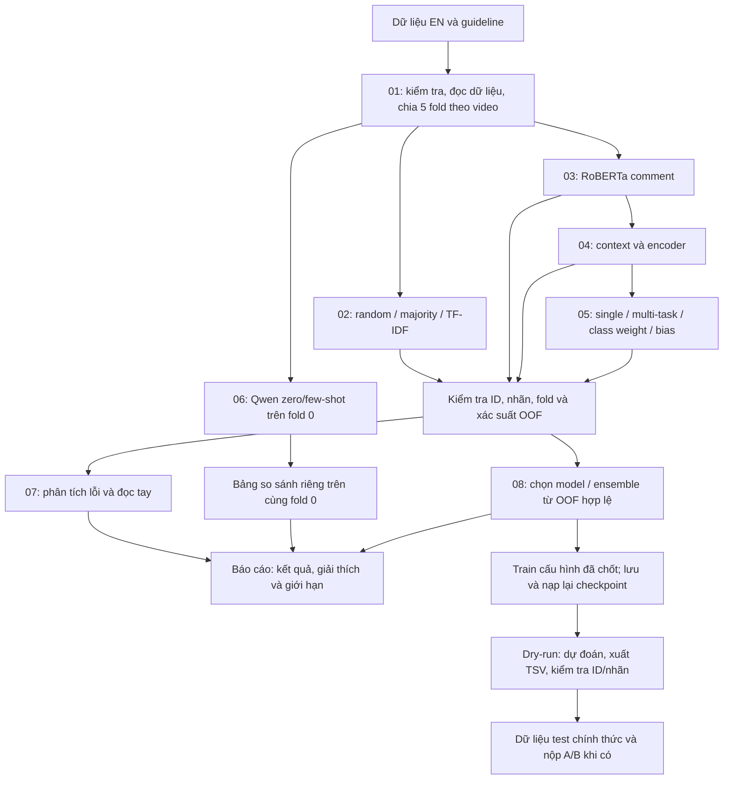

# Pipeline và kế hoạch tiếp theo — A/B English
Cập nhật: **18/10/2026**. Đọc cùng [roadmap](ROADMAP.md), [handoff](../HANDOFF_CS221.md)
và [worklog](../WORKLOG_CS221.md).

## 1. Mục tiêu và đầu ra
Một comment YouTube, có thể kèm title/description, được phân loại:
- A: stereotype `no / yes`.
- B: hate speech `no / yes_implicit / yes_explicit`.

Sản phẩm cần bàn giao: bộ thí nghiệm có thể kiểm chứng, bảng kết quả tách đúng phạm vi đánh giá,
phân tích lỗi, cấu hình hệ thống cuối, model/tokenizer có thể nạp lại, file dự đoán đúng định dạng
và báo cáo. Chỉ chạy hết notebook chưa đáp ứng đủ các đầu ra này.

## 2. Luồng tổng thể

LLM không đi vào phép trung bình xác suất của notebook 08: hiện chỉ có nhãn ở fold 0.
Few-shot lấy ví dụ từ fold 1–4, không lấy mẫu/video đang chấm.

## 3. Bản đồ notebook và trạng thái thật
| Notebook | Đầu vào → đầu ra | Trạng thái 18/10 |
|---|---|---|
| 01 | TSV/guideline → EDA, cách hiểu nhãn, folds | Đã chạy; folds đã kiểm chứng |
| 02 | Fold chuẩn → baseline và OOF | Đã chạy; OOF hợp lệ |
| 03 | Comment/nhãn → RoBERTa OOF, lịch sử train | Đã chạy; OOF hợp lệ; chưa thấy checkpoint lưu |
| 04 | RoBERTa + các input/encoder → đối chứng context | Đã chạy; DeBERTa A/B failed, cấu hình khác có OOF hợp lệ |
| 05 | Cấu hình nền → single/MT/cw/bias | OOF hợp lệ; bảng master bị mất phân biệt biến thể |
| 06 | Hướng dẫn + 0 hoặc vài ví dụ → 4×599 nhãn | Full đã kiểm chứng; đã ghép 4 dòng vào master |
| 07 | OOF → biểu đồ và bảng lỗi | Đã chạy; 0/30 mẫu lỗi B có ghi chú; cần đồng bộ sau khi chốt model |
| 08 | OOF → chiến lược, recipe, dry-run TSV | Đã chạy; greedy lỗi NaN; recipe cần xét lại; dry-run đã kiểm tra format |

## 4. Hướng nghiên cứu giữ lại
1. **Supervised comment-only là hướng chính.** Qwen few-shot chưa vượt các baseline trên cùng fold 0.
2. **Context là thí nghiệm đối chứng có kết quả hạn chế.** Không suy rằng ngữ cảnh vô ích nói chung;
   chỉ kết luận các cách đưa context đang thử chưa đem lại cải thiện ổn định.
3. **Multi-task đáng giữ để so sánh.** Cấu hình MT không class weight/bias đạt A 0,7354 và B 0,6006
   theo mean 5 fold. Phải phục hồi đầy đủ các biến thể trước khi kết luận cw/bias hữu ích hay không.
4. **Ensemble chỉ chọn sau khi sửa đầu vào hỏng.** Công thức A top-3/B single hiện có là ứng viên cũ,
   chưa phải quyết định cuối sau kiểm tra.
5. Tạm không mở thêm model lớn, fine-tune Qwen, subtask C hay ngôn ngữ khác.
   Chỉ mở một thí nghiệm bổ sung khi lỗi đọc tay chỉ ra giả thuyết rõ và còn thời gian.

## 5. Kế hoạch thực hiện có thứ tự
Thời lượng là ước lượng công việc, không phải cam kết runtime GPU. Chưa có hạn nộp xác nhận.

| Mốc | Việc cụ thể | Đầu ra / điều kiện hoàn tất | Nguồn lực |
|---|---|---|---|
| **P0 — xong 18/10** | Audit 06, OOF, bảng kết quả; merge Qwen; đồng bộ tài liệu | Audit trước/sau, 4×599 hợp lệ, master 28 dòng | CPU, đã làm |
| **P1 — làm tiếp ngay** | Kiểm tra OOF ở nơi nạp; loại/đánh dấu failed DeBERTa; sửa average để trọng số 0 không nhân NaN; thêm experiment/run_id; dựng lại bảng 05 | 2 run hỏng không thể vào ensemble; 12 dòng đối chiếu notebook 05 không đè nhau; các dòng LLM giữ nguyên; test có mẫu NaN/ID lệch/merge lặp | CPU, dự kiến 1 buổi |
| **P2 — đọc lỗi và chốt giải thích** | Đọc 30 lỗi B, ghi kiểu khó; đối chiếu Qwen trên fold 0; viết nháp kết luận 04–06 | 30/30 có ghi chú, 5–10 ví dụ tiêu biểu có ID, mô tả lỗi và giới hạn; không sửa gold theo dự đoán | User + hỗ trợ, 1–2 buổi |
| **P3 — chọn lại hệ thống** | Chạy riêng phần chọn chiến lược 08 trên OOF sạch; đối chiếu single/top-3/greedy và từng fold; đồng bộ phân tích 07 và summary | Recipe mới có nguồn OOF/hash, metric hợp lệ, lý do chọn; loại các số NaN khỏi báo cáo; cập nhật bảng tổng hợp | Chủ yếu CPU, 1 buổi; không Run All phần dry-run train nếu chưa cần |
| **P4 — đóng gói suy luận** | Bổ sung save/reload; kiểm thử dry-run ở phiên mới; sau khi chốt mới train trên toàn bộ train EN | Model/tokenizer/config/label map/manifest; nạp lại cho dự đoán nhất quán; TSV đủ đúng ID/nhãn | GPU chỉ ở bước train cần thiết, runtime đo thực tế |
| **P5 — báo cáo và nộp** | Viết dữ liệu/phương pháp/kết quả/ablation/lỗi/giới hạn; xác minh yêu cầu BTC khi đến bước nộp | Báo cáo môn; file test A/B khi có dữ liệu chính thức; worklog ghi kết quả nộp thực tế | 2–3 buổi viết; lịch BTC xác nhận riêng |

Có thể viết phần dữ liệu và phương pháp trong lúc sửa P1. P3 chỉ chốt sau P1;
P4 chỉ train cấu hình cuối sau P3. Nếu hạn gấp: ưu tiên P1/P2/P3 và báo cáo bằng CV;
không bắt buộc chạy lại DeBERTa, không cần chạy thêm LLM.

## 6. Quy định đánh giá và lưu kết quả
- Dùng nguyên split video hiện tại; fit TF-IDF, class weight và mô hình chỉ từ train fold.
- Mỗi artifact phải xác thực: ID đủ/không trùng, gold/fold/video khớp, xác suất hữu hạn
  trong [0,1], tổng hàng ≈1, nhãn dự đoán khớp argmax với thứ tự nhãn chuẩn.
- Với bias/ensemble, tách dữ liệu dùng chọn và dùng chấm. Các OOF hiện có vẫn là kết quả phát triển;
  không gọi hậu xử lý OOF là nested CV hoàn toàn độc lập. Muốn ước lượng toàn pipeline thật nghiêm ngặt
  cần thêm outer split và tạo lại inner OOF chỉ từ outer-train.
- Báo cáo supervised: mean ± std 5 fold (std ddof=0), kèm F1 từng lớp. Qwen: fold 0, n=599, std để trống.
- Bảng so Qwen phải lấy các baseline trên cùng 599 ID; ghi rõ input khác nhau.
- Không dùng kết quả dry-run trên fold 0 đã tham gia lựa chọn để tuyên bố điểm test.
- Khóa thí nghiệm dự kiến: `notebook + model + input + subtask + experiment/run_id`;
  cấu hình lưu seed, folds hash, precision, class weight, bias và nguồn checkpoint.
- Tách trạng thái `completed_valid`, `failed_nonfinite`, `pending_revalidation`;
  bảng master hiện tại chưa có đầy đủ cơ chế này — thuộc P1.
- Không kết luận ý nghĩa thống kê chỉ từ thắng 4/5 fold; dùng số fold như thông tin mô tả.

## 7. Điểm dừng và điều kiện mở rộng
Mốc gần nhất là **P1**, chưa cần gửi thêm lượt train lên Kaggle.
Nếu P1/P3 xong và comment-only/MT vẫn dẫn đầu, dùng hướng đó để hoàn thiện sản phẩm.
Nếu P2 cho thấy một kiểu lỗi lặp lại đủ rõ, ghi trước giả thuyết, baseline, cách đo và ngân sách
cho đúng một thử nghiệm; không chỉnh prompt theo fold 0 rồi gọi kết quả mới là test độc lập.

Sau mỗi mốc: cập nhật [worklog](../WORKLOG_CS221.md), [handoff](../HANDOFF_CS221.md)
và mục tiến độ trong roadmap; lưu artifact trước khi đổi trạng thái.

