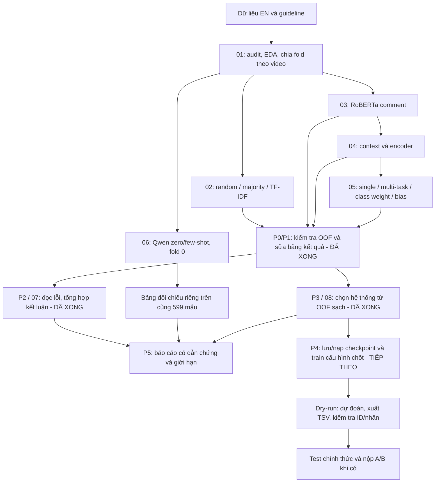

# Roadmap và pipeline — CS221 / StereoQueerEval
**Một tài liệu kế hoạch duy nhất — cập nhật 18/10/2026 sau khi hoàn thành P3 bằng CPU.**
Phạm vi: **Subtask A + B, English**.
[Handoff](../HANDOFF_CS221.md) là bản bàn giao trạng thái; [worklog](../WORKLOG_CS221.md) là lịch sử công việc.
Nội dung PIPELINE.md đã được gộp vào file này.

## 1. Bạn đang ở đâu, nhanh hay chậm?
**Vị trí hiện tại: P3 phần kỹ thuật đã xong; tiếp theo là P4 — lưu/nạp model và suy luận. P0/P1/P2 đã hoàn thành.**
Đã chốt chiến lược A/B có bằng chứng; cần nắm kết luận P3, hoàn thiện checkpoint và báo cáo.

| Phần công việc | Trạng thái hiện tại |
|---|---|
| Hiểu dữ liệu và thiết lập đánh giá | Xong: EDA, 2.989 mẫu EN, 243 nhóm video, 5 fold |
| Baseline và model chính | Đã chạy TF-IDF, RoBERTa; có OOF hợp lệ |
| Context, multi-task, Qwen | Đã chạy; Qwen 4×599 dự đoán đã kiểm chứng; DeBERTa được ghi nhận là failed |
| Kiểm tra và sửa dữ liệu kết quả — P0/P1 | **Xong:** phục hồi bảng 05, chặn OOF hỏng, sửa NaN ensemble, 35 test đạt |
| Đọc lỗi và viết kết luận — P2 | **Xong:** user đọc 30/30; đã kiểm tra nguồn, tổng hợp 8 ví dụ, đối chiếu 7 mẫu Qwen và viết kết luận riêng |
| Chọn lại hệ thống cuối — P3 | **Xong:** A greedy+bias 0,7460; B top-3+bias 0,6075; 07/08/summary đã cập nhật |
| Lưu/nạp model và đóng gói suy luận — P4 | Chưa xong; chưa thấy checkpoint lưu trong dự án |
| Báo cáo môn và nộp cuộc thi — P5 | Chưa xong; lịch/hạn môn cần xác nhận |

**Đánh giá tốc độ:** so với lịch gốc, phần chạy thí nghiệm đang đi trước.
Lịch gốc dành 12–25/10 cho bước 2–3, 26/10–08/11 cho context và 09–22/11 cho multi-task/LLM;
artifact hiện có cho thấy các lượt này đã chạy trong 11–14/10 và được rà soát/sửa kết quả ngày 18/10.
Đây là so sánh mốc công việc, không có nghĩa đã hoàn thành báo cáo hoặc hệ thống nộp bài.

**Chưa thể kết luận dư hay thiếu thời gian theo hạn môn**, vì ngày nộp chưa được xác nhận.
Không dùng “8/8 notebook” làm phần trăm hoàn thành đồ án.
Điểm cần tập trung lúc này là checkpoint, suy luận tái lập và đưa kết luận P2/P3 vào báo cáo;
chưa cần thêm model hay chạy lại toàn bộ 01–08.

**Cách đọc số thứ tự:** notebook 01–08 là các file thí nghiệm. P0–P5 là các mốc hoàn thiện
sau khi đã có kết quả; **P2 không có nghĩa quay lại notebook 02**.

## 2. Bài toán và sản phẩm cần bàn giao
Input là comment YouTube, có thể kèm tiêu đề và mô tả video.
- **A:** có stereotype về LGBTQIA+ không → `no / yes`.
- **B:** có hate speech không, thể hiện thế nào → `no / yes_implicit / yes_explicit`.
- Metric chính: macro-F1, kèm F1/recall từng lớp; không chọn model chỉ vì ô `no/no` lớn.
- Train EN hiện có: 2.989 mẫu / 243 nhóm video; dùng nguyên `data/splits/folds_en.csv`.
- Scope hiện tại không mở rộng sang C/IT/NL/Persian. 100 mẫu Persian development là nhánh riêng,
  không nhập vào EN folds hay tính chung với metric EN.

Sản phẩm: thí nghiệm có thể kiểm chứng, bảng kết quả đúng phạm vi đánh giá, phân tích lỗi,
recipe có lý do lựa chọn, model/tokenizer/config có thể nạp lại, TSV dự đoán hợp lệ và báo cáo.
Hạn nộp môn **chưa xác nhận**. Lịch BTC ghi ở phần cuối là thông tin cũ, cần kiểm tra trước lúc nộp.

## 3. Pipeline từ dữ liệu đến hệ thống

Qwen hiện chỉ có nhãn trên fold 0; không đưa vào ensemble xác suất của notebook 08.
Few-shot lấy ví dụ từ fold 1–4, không trùng ID/video của tập đang chấm.

## 4. Bản đồ 8 notebook
| Notebook | Câu hỏi cần trả lời | Đầu ra / trạng thái |
|---|---|---|
| 01 — EDA | Dữ liệu có gì, nhãn nào khó, cần chia thế nào? | Dữ liệu/folds đã kiểm tra; đọc guideline và ví dụ trước khi giải thích lỗi |
| 02 — classical | Cách đơn giản làm được tới đâu? | Random/majority/TF-IDF, OOF và mốc so sánh |
| 03 — transformer | Fine-tune RoBERTa có hơn TF-IDF không? | Có OOF hợp lệ A/B, chưa thấy checkpoint lưu |
| 04 — context | Title/description giúp hay gây nhiễu? | RoBERTa/Twitter-RoBERTa hợp lệ; DeBERTa failed, không dùng điểm giả majority |
| 05 — multi-task | Học A/B chung, class weight và bias có ích không? | **Bảng 12 dòng đã phục hồi** từ OOF; code logger đã sửa |
| 06 — LLM | Không fine-tune, Qwen zero/few-shot làm được tới đâu? | Full 4×599, 0 failed attempts; đã kiểm chứng và merge |
| 07 — error analysis | Model sai ở đâu và vì sao? | 30/30 ghi chú P2 được giữ; 12 code cell đã chạy với OOF P3, có kết luận và output riêng |
| 08 — ensemble/submission | Chọn hệ thống nào và xuất dự đoán thế nào? | P3 đã chọn bằng script CPU; notebook 9 code cell đã chạy, train/test P4 mặc định tắt |

Cả 8 notebook từng chạy đầy đủ trước P1. Sau sửa P1/P3, **07 và 08 đã được chạy lại trên CPU**;
05 chưa train/chạy lại toàn notebook, bảng 12 biến thể được phục hồi từ OOF. Notebook 06 và dự đoán gốc giữ nguyên.
Bản trước P1/P3 nằm trong `outputs/audit/2026-10-18-p1/before/` và `outputs/audit/2026-10-18-p3/before/`.
Dry-run cũ không đại diện cho recipe P3 mới; cần kiểm tra save/reload và suy luận ở P4.

## 5. Kết quả và hướng nghiên cứu hiện tại
### Supervised — mean ± std 5 fold theo video
| Cấu hình | A | B |
|---|---:|---:|
| TF-IDF comment | 0,7002 ± 0,0209 | 0,5249 ± 0,0138 |
| RoBERTa comment | 0,7274 ± 0,0098 | 0,5856 ± 0,0179 |
| Twitter-RoBERTa-hate comment | 0,7335 ± 0,0115 | 0,5870 ± 0,0114 |
| Multi-task cùng encoder, không cw/bias | 0,7354 ± 0,0111 | 0,6006 ± 0,0259 |

Các số này là điểm phát triển/CV, không phải test độc lập của BTC.
Bảng các biến thể 05: [nb05_restored.csv](outputs/results/nb05_restored.csv).

Context chưa cải thiện ổn định: A thêm title+description +0,0014 nhưng thắng 3/5 fold;
B thêm title −0,0048, title+description −0,0164, ghép thẳng −0,0350 so với comment-only.
Không kết luận ngữ cảnh luôn vô ích; chỉ mô tả kết quả của các cách đưa ngữ cảnh đã thử.

### LLM — cùng fold 0, 599 mẫu, không có std 5 fold
| Hệ thống | A | B |
|---|---:|---:|
| Qwen zero-shot | 0,6074 | 0,4612 |
| Qwen few-shot | 0,6927 | 0,5187 |
| TF-IDF comment | 0,7056 | 0,5245 |
| RoBERTa comment | 0,7314 | 0,6171 |

Qwen Q4_K_M dùng title+description+comment; baseline trong bảng dùng comment.
Few-shot cải thiện F1 implicit B 0,1611 → 0,3402 nhưng F1 explicit giảm 0,5362 → 0,5132.
Giữ Qwen như thí nghiệm đối chiếu; **supervised ensemble đã chọn ở P3 là hướng chính hiện tại**.

### Sau P3 — trạng thái hiện hành
- **A:** greedy + bias, 0,746020 ± 0,010278; **B:** top-3 mean + bias, 0,607455 ± 0,012700.
- So 6 chiến lược/task trên 9 ứng viên hợp lệ, 60 điểm theo fold. Chọn theo quy tắc gain ≥0,005 so với single tốt nhất có/không bias.
- B: F1 implicit 0,4313 → 0,4631; no giảm, explicit gần như giữ nguyên. Không phải mọi lớp đều cải thiện.
- Thành phần/trọng số/bias đều fit ngoài fold đang chấm. Điểm vẫn là development OOF cross-fit, chưa phải nested CV độc lập toàn pipeline hoặc test của recipe toàn OOF.
- Master **40 dòng**: 36 completed_valid, 2 failed_nonfinite, 2 superseded_p3. `load_results()` mặc định trả 36 valid.
- Giữ nguyên 32 OOF gốc (30 hợp lệ, 2 DeBERTa NaN); OOF của chiến lược P3 ở `outputs/selection/`.
- **38 test đạt**, 07/08 chạy xong không lỗi; 54 artifact nguồn không đổi, ghi chú P2 được giữ nguyên.
- Recipe, nguồn/hash, fold decisions và hướng dẫn đọc: [P3_REVIEW.md](outputs/selection/P3_REVIEW.md).

## 6. Kế hoạch còn lại và tiêu chí hoàn thành
| Mốc | Việc phải làm | Xong khi | Ước lượng / trạng thái |
|---|---|---|---|
| **P0** | Audit 06/OOF và merge Qwen | 4×599 khớp nhãn/cache/điểm, có bản sao | **Xong 18/10** |
| **P1** | Chặn OOF lỗi, sửa NaN ensemble, định danh thí nghiệm, phục hồi bảng 05 | 12 dòng 05, 4 dòng Qwen giữ nguyên, 35 test đạt, smoke greedy hợp lệ | **Xong 18/10, không train mới** |
| **P2** | Đọc 30 lỗi B, đối chiếu Qwen, viết kết luận context/MT/LLM | 30/30 đã kiểm tra, 8 ví dụ tiêu biểu, 7 mẫu Qwen cùng fold 0; giữ nguyên gold/ghi chú gốc | **Xong 18/10:** [báo cáo P2](outputs/error_analysis/P2_REVIEW.md) |
| **P3** | So single/top-3/greedy/bias, đồng bộ 07/08/summary | Recipe có nguồn/hash, 12 dòng chiến lược và 60 điểm theo fold, lý do chọn, 38 test đạt | **Xong 18/10 bằng CPU**, xem hướng dẫn đọc trong báo cáo P3 |
| **P4 — tiếp theo** | Bổ sung save/reload; dry-run ở phiên mới; train cấu hình chốt trên toàn bộ train khi cần | Model/tokenizer/config/label map; nạp lại dự đoán nhất quán; TSV đúng đủ ID/nhãn | GPU ở bước train cần thiết, đo runtime thực tế |
| **P5** | Viết báo cáo; xác minh lịch/format BTC khi đến bước nộp | Báo cáo môn, kết quả nộp thực tế nếu có test; ghi worklog | 2–3 buổi viết, lịch BTC xác nhận riêng |

Ước lượng dùng để sắp xếp công việc, không phải cam kết ngày hoàn thành.
Có thể viết phần dữ liệu/phương pháp ngay trong P2; P3 phải xong trước khi train cấu hình cuối ở P4.
Nếu hạn gấp: ưu tiên kết quả sạch, phân tích lỗi, bảng so sánh và báo cáo CV;
không bắt buộc chạy lại DeBERTa hay mở thêm LLM/ngôn ngữ.

**Việc trước mắt của người học:** đọc mục 1–5 notebook 08 và bảng `p3_strategies.csv`,
hiểu vì sao chọn A greedy+bias/B top-3+bias, xem đánh đổi của lớp implicit và các fold giảm.
[Hướng dẫn P3 mục 5](outputs/selection/P3_REVIEW.md) có trình tự và đoạn kết luận.
**Việc kỹ thuật kế tiếp P4:** bổ sung save/reload cho đúng thành phần recipe, thử nạp ở phiên mới,
rồi train cấu hình chốt khi cần. Chưa chạy P4; cờ train/test ở 08 đang False.
Notebook 07 đã bảo toàn ghi chú: lỗi P3 xuất ra thư mục theo hash nguồn, không ghi đè CSV P2.

## 7. Điều kiện hợp lệ và cách lưu kết quả
1. Dùng nguyên split theo video; fit TF-IDF/class weight/mô hình chỉ từ train fold.
2. OOF phải đủ đúng ID, gold/fold/video khớp; không thiếu/trùng; xác suất hữu hạn trong [0,1],
   tổng hàng ≈1, nhãn dự đoán khớp argmax. Các model trong ensemble phải cùng thứ tự ID/gold/fold/video.
3. Loại trọng số 0 trước phép nhân; thành phần có trọng số dương không hợp lệ phải dừng.
4. Khóa kết quả hiện tại: `notebook + model + input + subtask + experiment + evaluation_scope`.
   Biến thể raw/bias và single/MT/cw có experiment riêng, không đè nhau.
5. Supervised báo cáo mean ± std 5 fold (ddof=0), kèm F1 lớp. Qwen fold 0 có n=599, std để trống.
6. Chọn model/bias/ensemble tách dữ liệu chọn và chấm. Hậu xử lý trên OOF hiện có là cross-fitting tầng quyết định,
   chưa phải nested CV độc lập toàn pipeline. Muốn đánh giá toàn pipeline nghiêm ngặt cần outer split và
   tạo lại inner OOF chỉ từ outer-train.
7. Điểm dry-run fold 0 đã tham gia phát triển chỉ kiểm tra quy trình, không gọi là điểm test.
8. Không kết luận ý nghĩa thống kê chỉ vì thắng 4/5 fold; số fold thắng là mô tả.
9. Seed 42 và lưu phiên bản/precision thực tế. Không mở/sửa TSV gốc bằng Excel.
10. Sau mỗi mốc kiểm chứng: thêm worklog, đồng bộ handoff và file roadmap này.

## 8. File và thao tác cần biết
- [Audit notebook 06 và kết quả cũ](outputs/audit/2026-10-18/REVIEW.md)
- [Báo cáo sửa P1](outputs/audit/2026-10-18-p1/P1_REVIEW.md)
- [Kiểm tra và tổng hợp P2](outputs/error_analysis/P2_REVIEW.md) / [audit 30 mẫu](outputs/audit/2026-10-18-p2/sample_review.json)
- [Master có trạng thái](outputs/results/all_results.csv) / [chỉ kết quả hợp lệ](outputs/results/validated_results.csv)
- [Bảng 12 biến thể notebook 05](outputs/results/nb05_restored.csv)
- `outputs/llm_predictions/`, `outputs/llm_cache/`: 4×599 nhãn và bằng chứng Qwen.
- `outputs/submissions/recipe.json`, `outputs/results/summary_table.csv`: đã cập nhật P3.
- `outputs/results/p3_strategies.csv`, `p3_folds.csv`, `p3_candidates.csv`: bảng P3.
- `outputs/selection/`: OOF, manifest/hash, fold decisions và [báo cáo P3](outputs/selection/P3_REVIEW.md).
- `scripts/run_p3_selection.py`: tái tạo P3 bằng CPU; không train model.
- `scripts/audit_artifacts.py`: kiểm tra lại output; `scripts/repair_p1_results.py`: phục hồi bảng 05/đánh dấu trạng thái.
- `tests/`: **38 kiểm tra đã đạt** sau sửa P3.
- `kaggle/merge_nb06_results.py` ở thư mục cha: nhập output Qwen sau tải về; **không chạy trên Kaggle**.
- Bundle Kaggle cũ chưa được đóng gói lại với sửa P1/P3. Không chạy lại bundle cũ để ghi đè kết quả trên máy.
- Không chạy `../kaggle/nb06_tools/build_bundle.py` tùy tiện: hiện script có thể sinh đè notebook 06 đã chạy.
  Sao lưu trước nếu cần sửa/đóng gói lại.

## 9. Lịch và phạm vi nộp
Hạn môn chưa xác nhận. Tài liệu BTC đang lưu mô tả test EN 743 mẫu từ video khác, dự kiến tháng 01/2027;
kế hoạch cũ ghi đánh giá 10–31/01/2027 và system paper 02/2027. **Chưa xác minh lại các mốc này trong phiên 18/10.**
Trước khi nộp phải kiểm tra nguồn chính thức, quy cách header/tên file và giới hạn lượt nộp.
Nộp A và B riêng; không có yêu cầu tự suy ra rằng phải làm toàn bộ subtask/ngôn ngữ.

## 10. Ghi chép BTC từ roadmap trước
Giữ nguyên nội dung ghi chép gốc dưới đây để truy vết; không dùng cụm “2 tuần nữa” làm mốc hiện tại.

## Cập nhật tin tức từ BTC 
    - Thông tin về cuộc thi sắp tới: Thank you for your interest in our shared task. We are currently working on the evaluation/scoring script and on getting the three Codabench platforms ready (it will be three different pages for the three subtasks). We will make them available in approximately 2 weeks. As soon as they are ready we will announce it on the Google Group.
    - Release test triplets: Dear StereoQueerEval participants,

    We are happy to announce that we have decided to release 100 Persian (Farsi) text triplets (title, description, comments) as part of the development set. The remaining Persian data will be released as part of the test set in January, when the evaluation period starts.

    The archive containing the training data is password-protected. You can open it with the following password.

    Password Farsi Development Data: Rainbow2027!

    Once again, the new file is distributed as a password-protected RAR archive. We recommend extracting it with WinRAR on Windows; on macOS you can use the command-line version of WinRAR or a free tool that supports encrypted RAR archives, such as The Unarchiver or Keka; on Linux, unrar x archive.rar.

    Happy experimenting!

    Best,
    The StereoQueerEval Organizers 🌈